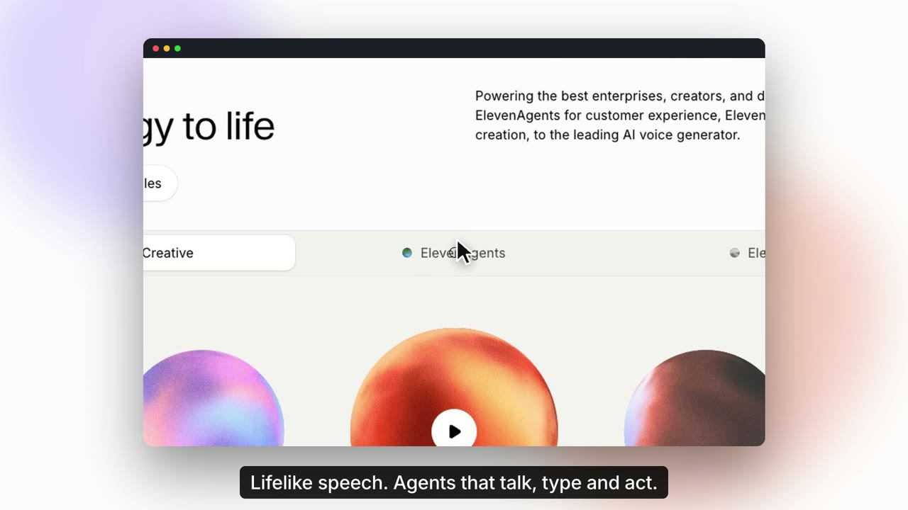

# basivo-promo

A Claude Code plugin that makes promo, launch and demo films of your web, mobile and desktop
apps, for sales and marketing teams.

You give it what you have: a website, a logo, images, screen recordings. It adopts your
colours, font, logo and copy, records the real product at 60 fps, edits the footage like
Screen Studio, and Claude composes a film on [HyperFrames](https://github.com/heygen-com/hyperframes)
with a local voiceover, generated music and captions in 16:9, 9:16 and 1:1.

- **Edited, not templated.** Each film gets its own storyline (launch film, Screen Studio demo,
  fast social ad, explainer) chosen with you. Real recordings get speed ramps on idle stretches,
  camera zooms into every click and keystroke, pull-backs on page changes, a smoothed cursor
  and click ripples.
- **Your brand, automatically.** `promo extract https://your.site` reads colours, font, logo,
  headings, features and stats, hides cookie banners, and writes a taste profile.
- **Everyone has their own taste.** `promo design "<product>"` proposes three design directions
  from [UI UX Pro Max](https://github.com/nextlevelbuilder/ui-ux-pro-max-skill) data. Plus five
  built-in styles, personal and team styles, and a style builder (`/promo-style`).
- **Private by design.** Every command asks for confirmation in a popup. Passwords go from a
  local popup (or your keychain) straight into the browser and never reach the model.
- **Local media.** Voice: [Kokoro-82M](https://huggingface.co/hexgrad/Kokoro-82M) on your CPU.
  Music: [@simpllyf/ditty](https://github.com/simpllyf/ditty). Render: HyperFrames + ffmpeg,
  checked for an audio track and normalised to −14 LUFS.

## Demo

[](docs/demo/elevenlabs-demo.mp4)

[Watch the 60-second film (MP4, female voiceover and music)](docs/demo/elevenlabs-demo.mp4). Made
end to end by the plugin from `https://elevenlabs.io`: brand extracted, two real flows recorded
and edited (camera zooms to each click), Kokoro voiceover, ditty music, rendered on HyperFrames.
Unofficial demo; not affiliated with ElevenLabs. Trademarks belong to their owners.

## Why basivo-promo

### What it adds on top of HyperFrames

[HyperFrames](https://github.com/heygen-com/hyperframes) is the engine: HTML + GSAP compositions
rendered frame by frame to MP4. basivo-promo is the production layer a sales or marketing team
needs around it.

| | HyperFrames on its own | With basivo-promo |
|---|---|---|
| Product footage | You bring screenshots or clips | `record-web` drives the real app: clicks, typing, scrolling, logins, at 60 fps and 2× DPR, with an event log |
| Editing footage | Hand-animate zooms and cursors | `screen` edits automatically from the event log: speed ramps over idle time, camera zooms to each click and keystroke, pull-backs on page changes, smoothed cursor, click ripples |
| Brand | Set colours and fonts by hand | `extract` reads colours, font, logo, headings and stats from your site; `design` proposes three directions from UI UX Pro Max data |
| Voice and music | `media-use` can call HeyGen services | Kokoro-82M voice and ditty music, both local and free; no account needed |
| Credentials | Not in scope | `${secret:name}` from a local popup or keychain, typed as dots, never sent to the model; sessions saved with mode 600 |
| Safety | Runs what it is told | Every command shows a step-by-step permission popup; uploads (`publish`, `cloud`, `lambda`) are flagged; pasted secrets are blocked; telemetry off |
| Delivery | Renders an MP4 | Checks an audio track exists, normalises to −14 LUFS / −1.5 dBTP, writes `manifest.json` with SHA-256 hashes, 16:9 / 9:16 / 1:1 |
| Reproducible | Latest version | Pinned HyperFrames version, so a project renders the same next month |
| Workflow | Prompt and iterate | Assets first, storyline options to pick from, an 8-step checklist and a draft before the final |

### Compared with other ways to make a product video

- **Screen recorders** (Screen Studio, Loom): great auto-zoom, but you record by hand on one
  machine and edit one video at a time. basivo-promo records from a script, so the flow is the
  same every time and re-records in seconds when the UI changes.
- **AI text-to-video generators**: fast, but they invent footage. Sales videos must show the
  real product; basivo-promo only uses what it recorded or what you gave it.
- **Code-based video frameworks** (Remotion, Motion Canvas): powerful, but you build the
  recording, editing, brand and audio pipeline yourself. basivo-promo ships it, inside
  Claude Code.
- **Agencies and editors**: the best result, at days and budget per video. basivo-promo makes a
  draft in minutes that an editor can still open and change: every film is plain HTML.

## Install

Requirements: [Claude Code](https://claude.com/claude-code), [uv](https://docs.astral.sh/uv/),
Node.js 22+, ffmpeg, and Google Chrome (or Edge, or `uvx playwright install chromium`).
Python dependencies are installed by uv on first use; HyperFrames runs through npx at a
pinned version.

```text
/plugin marketplace add mohamedabubasith/basivo-promo
/plugin install basivo-promo@basivo-promo
```

Then, once: ask Claude to "run promo doctor" and "run promo setup" (downloads the 120 MB voice
model and checks its SHA-256). Without it, use the macOS `say` voice or no voice.

## Use

```text
/promo https://elevenlabs.io, a 30 second launch film for our sales deck
```

Claude asks which assets you have, adopts your brand, proposes storylines, records the flows
you agree on, composes, and renders a draft for review.

| Command | What it does |
|---|---|
| `/promo [product, URL or goal]` | Make a new film |
| `/promo-render <promo.json>` | Re-render after edits (`--quality draft\|looks\|delivery`) |
| `/promo-style [name or look]` | Build and preview your own taste profile |

Output, under `promos/<product>/<date>-<slug>/`:

```text
promo.json              brief, site, flows, style
assets/                 brand/, recordings/, audio/, images/, video/
16x9/ 9x16/ 1x1/        one HyperFrames project per format (edit and re-render)
master_16x9.mp4  vertical_9x16.mp4  square_1x1.mp4
manifest.json           durations, loudness, SHA-256 of every output
```

## CLI

```text
promo new "Acme" --url https://acme.dev --length 30 --formats 16x9,9x16
promo extract <folder> <url|image> [--logo]
promo design "voice AI platform" [--write 2 --name house --brief <promo.json>]
promo record-web <promo.json> [--flow tour]
promo screen <promo.json> assets/recordings/tour.mp4 --formats 16x9,9x16
promo record <promo.json> ios|android|mac --seconds 20 --name onboarding
promo import <promo.json> clip.mov --name onboarding
promo scaffold <promo.json>
promo voice <promo.json> script/vo.json
promo music <promo.json> --seconds 30
promo render <promo.json> [--quality draft|looks|delivery] [--formats 16x9]
promo style-sample <style>
promo doctor
```

## Security model

- **Confirmation popup for every action.** A `PreToolUse` hook turns every `promo` command into
  a Claude Code permission prompt that says in plain words what will happen: which site, how
  many screenshots, which secrets by name, where files go.
- **Secrets never reach the model.** promo.json may only reference `${secret:name}`. The value
  comes from `PROMO_SECRET_<NAME>`, your OS keychain (service `basivo-promo`), or a native
  masked popup, and goes straight into the browser. It is not printed, logged or saved; fields
  that received one are typed as dots on screen. Literal values typed into password
  fields are refused.
- **Login handover.** `promo login` lets you log in yourself; only session cookies are saved,
  in `~/.basivo-promo/sessions/` with mode 600. The hook denies any tool access to that folder,
  keychain reads for `basivo-promo`, and `PROMO_SECRET_*` lookups.
- **Pasted secrets are stopped.** A `UserPromptSubmit` hook blocks messages containing API keys,
  tokens, private keys or `password:` assignments before they are sent
  (`BASIVO_PROMO_PROMPT_GUARD=0` turns it off).
- **Private data on screen.** `site.mask` hides selectors (emails, customer names) in every
  recording and screenshot, across in-app navigation. All script output and the audit log (`~/.basivo-promo/audit.log`) are redacted.
- **Scoped browsing.** Recordings cannot navigate away from the site you named.
- **No silent uploads.** HyperFrames runs pinned with telemetry off; `publish`/`cloud`/`lambda`
  prompt with an upload warning, and raw `npx hyperframes` calls are denied.

Report vulnerabilities privately: see [SECURITY.md](SECURITY.md).

## Credits

Built on [HyperFrames](https://github.com/heygen-com/hyperframes) (Apache-2.0). Design data
from [UI UX Pro Max](https://github.com/nextlevelbuilder/ui-ux-pro-max-skill) (MIT). Motion rules
adapted from the [LottieFiles motion-design skill](https://github.com/LottieFiles/motion-design-skill)
(MIT) and [product-launch-motion](https://github.com/AbubakrChan/product-launch-motion) (MIT).
Bundled third-party files are listed in [NOTICE](NOTICE).

## License

MIT
